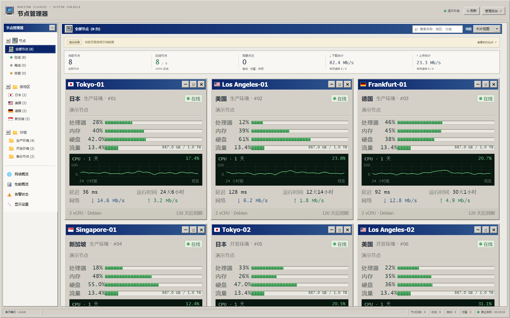
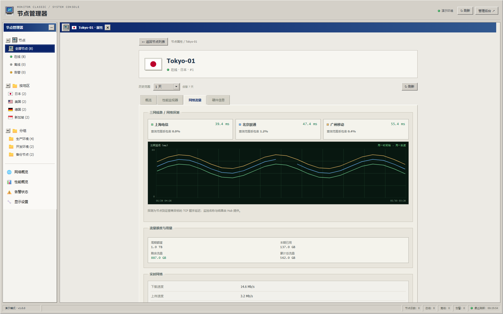
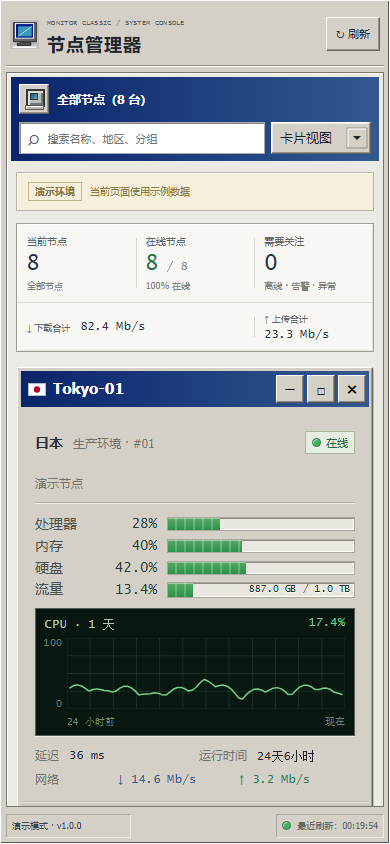

# Monitor Classic · 经典监控台

面向 [Monitor](https://github.com/monitor-probe/monitor) Hub 的独立中文主题，采用 Windows 95/2000 控制台风格：蓝色标题栏、立体边框、资源进度条、性能曲线与可折叠导航树。

[下载 v1.0.0](https://github.com/ayingQAQ/monitor-theme-classic/releases/tag/v1.0.0) · [官方主题规范](https://monitor-document.pages.dev/dev/theme) · [主题收录要求](https://github.com/monitor-probe/themes#收录你的主题)



## 安装

在最新版 Monitor Hub 后台「主题」→「从 GitHub 安装」填写：

```text
https://github.com/ayingQAQ/monitor-theme-classic
```

安装后选择 **Monitor Classic**。也可从 Release 下载 `theme.tar.gz` 上传安装。不要上传 GitHub 自动生成的源码 ZIP。

- 主题名称：`Monitor Classic`；短名：`monitor-classic`；版本：`1.0.0`。
- 后续更新从清单 `url` 指向的仓库读取最新正式 Release。
- 开发阶段的 `x86-monitor` 使用不同短名，请安装新的 `monitor-classic`，不会自动覆盖旧主题。
- 登录、节点管理和探测任务由 Hub 后台提供。

附件 `theme.tar.gz.sha256` 用于校验：

```powershell
Get-FileHash .\theme.tar.gz -Algorithm SHA256
Get-Content .\theme.tar.gz.sha256
```

```bash
sha256sum -c theme.tar.gz.sha256
```

## 功能

- 桌面默认三列、卡片等比缩放；手机单列。节点管理器默认展开，节点、地区和分组文件夹可独立收起。
- 在线状态、地区、分组筛选，名称搜索、紧凑视图、卡片最小化与恢复。
- CPU、内存、硬盘、流量进度、剩余/额度、延迟、运行时间、实时网速。
- 独立节点详情：概览、性能监视器、网络流量、硬件信息。
- 三网延迟使用同一时间轴和毫秒刻度，显示最新延迟及查询范围丢包率。运营商按 Hub 的探测名称识别；需要配置对应电信、联通、移动探测，未配置时明确提示。
- 文本/gzip WebSocket 串行解压、断线重连、轮询兜底，页面返回前台时恢复同步。
- 离线、等待首次上报、指标异常、加载、无历史、请求失败分别显示；缺失数据用 `N/A`。
- 剩余流量用额度减去 Hub 的计费用量 `month_used`，累计总流量取 Hub 累计接收与发送统计；支持不限量与超额状态。
- 历史范围跟随 `history_days`，时间戳定位曲线，缺失区间保留断点。节点名称、备注、公告和探测名称安全转义。

### 网络详情



### 手机布局



截图使用明确标记的演示数据，不对应真实服务器。电脑预览统一 **1920×1200（16:10）**，手机为 **390×844**。图片仅指定显示宽度，保留原始比例。

## 主题设置

在 Hub 主题管理中保存，字段声明于 `theme.json`：

| 设置 | 默认值 | 用途 |
| --- | --- | --- |
| `site_label` | 节点管理器 | 主标题 |
| `columns` | 3 | 宽屏列数，2–5 |
| `show_sidebar` | 开启 | 显示节点管理器 |
| `show_chart` | 开启 | 显示卡片 CPU 历史 |
| `show_traffic` | 开启 | 显示流量进度与网速 |
| `notice` | 空 | 公告 |

访客的紧凑视图、导航显示偏好保存在自己的浏览器；存储被禁用时仍能使用。

## 本地开发

需要 Node.js 24、npm，打包需要 Python 3.12+。依赖通过 `package-lock.json` 固定。

```bash
npm ci
npx playwright install chromium
npm run dev
```

打开 `http://127.0.0.1:4173/demo.html`。源码变化后自动重新构建，刷新查看。

| 入口 | 内容 |
| --- | --- |
| `/` | 真实同源 Hub 数据，不使用演示兜底 |
| `/demo.html` | 演示节点 |
| `/demo.html?scenario=edge` | 长名称、离线、等待、异常、过期、特殊分组 |
| `/demo.html?scenario=empty` | 空站点 |
| `/#/node/{id}` | 节点详情，支持刷新和浏览器返回 |

接入测试 Hub：

```powershell
$env:MONITOR_HUB = 'http://127.0.0.1:28080'
npm run dev
```

```bash
MONITOR_HUB=http://127.0.0.1:28080 npm run dev
```

开发服务器监听回环地址，代理 `/api/*`、WebSocket `/api/ws` 和 `/admin`；`MONITOR_HUB` 不进入生产代码，`PORT` 可调整本地端口。

## 检查与打包

```bash
npm run check
npm run format:check
npm test
npm run test:ui
npm run screenshots
npm run pack
```

浏览器回归覆盖 320–1920px、三列比例、四类详情、导航和文件夹收放、实际字号、焦点/滚动恢复、文本/gzip 更新、陈旧 HTTP 回复、断线恢复、历史失败重试、权限错误、存储不可用。

截图命令更新 `preview.png`，并生成桌面、1280px 桌面、手机、详情、三网及异常案例截图。生产包排除演示入口和数据脚本。

```text
theme.tar.gz
├── theme.json
├── preview.png
├── LICENSE
├── THIRD_PARTY.md
├── THIRD_PARTY_NOTICES.txt
└── dist/
    ├── index.html
    ├── assets/
    ├── flags/
    └── favicon.svg
```

归档根目录直接含 `theme.json`、`dist/`。固定顺序和时间戳，附 SHA-256；验证 gzip 完整性、路径、文件类型、体积、数量、版本和资源内容哈希。

## 发布与收录

公开仓库根目录提供 MIT `LICENSE`；清单 `url` 指向本仓库；版本 `1.0.0` 对应 `v1.0.0` tag。正式 Release 附件为 `theme.tar.gz` 与 `theme.tar.gz.sha256`，包内含 `preview.png`。

按 [主题列表 README](https://github.com/monitor-probe/themes#收录你的主题) 申请收录时，只在 `themes.txt` 末尾增加本仓库地址；名称、简介、作者、版本和截图从最新正式 Release 读取。官方 PR 检查会将包安装进最新版 Hub。

CI 执行类型、格式、单元、浏览器和安装包检查；`Verify published release` 工作流使用官方主题列表检查器下载本仓库正式 Release，验证真实 Hub 安装。模拟接口回归不能替代真实 Hub 验收。

## 结构与许可证

`src/api.ts` 处理协议和连接，`format.ts` 处理状态/数值，`chart.ts` 绘制 SVG，`main.ts` 组织页面，`config.ts` 读取清单。演示入口与生产入口单独构建。运行时不依赖外部 UI 库、字体或图标服务。

采用 [MIT](LICENSE) 许可证，第三方说明见 [THIRD_PARTY.md](THIRD_PARTY.md) 与 [THIRD_PARTY_NOTICES.txt](THIRD_PARTY_NOTICES.txt)。不包含微软专有图形素材，不属于微软官方产品。
